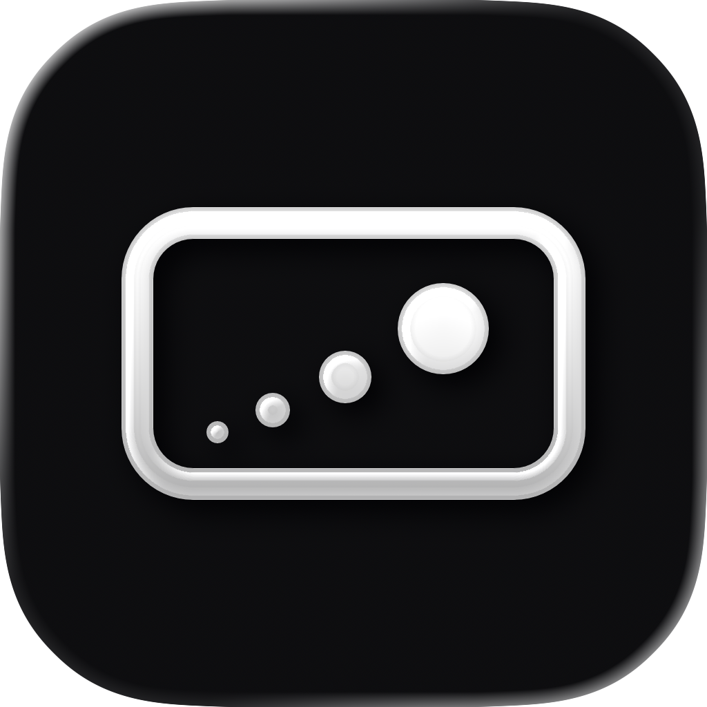
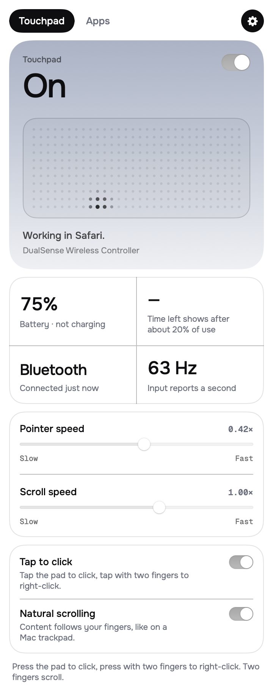

# DualPad

A macOS menu bar app that turns the touchpad on a PlayStation DualSense controller into a Mac trackpad. It runs in the background, steps aside in games that read the controller themselves, and does nothing else: no button mapping, no gyro.

Requires macOS 14 or later on Apple silicon, and a DualSense or DualSense Edge connected over USB or Bluetooth.



## Install

```sh
brew install --cask mansfera/tap/dualpad
```

Or download the DMG from [Releases](https://github.com/Mansfera/dualpad/releases) and drag the app to Applications. The app isn't notarized, so the first launch from the DMG needs right-click → Open.

On first launch, allow DualPad under **System Settings → Privacy & Security → Accessibility**. It needs that to move the pointer, click and scroll. After an update, macOS may ask again: turn DualPad off and on in that list.

## What it does

- **Trackpad:** one finger moves the pointer, pressing the pad clicks and pressing with two fingers right-clicks. Tap to click, two-finger tap to right-click, two-finger scrolling with momentum. Press and slide to drag.
- **Speed:** pointer and scroll speed sliders, and natural scrolling that starts out matching your Mac.
- **Games:** pauses in Steam, Unity, Unreal, SDL and Wine games, apps that declare controller support, and game streaming apps like GeForce NOW. You can ignore any other app, or keep the touchpad on in an app that looks like a game.
- **Controller:** battery level and charging, an estimate of the time left and of how long a full charge lasts, the connection and the input rate.
- **Menu bar:** right-click the icon to turn the touchpad on or off.
- **Updates:** tells you when a new version is out. That check on GitHub is the only network request DualPad makes, and you can turn it off in Settings.

DualPad reads the controller's input reports directly and never takes the controller away from other apps, so games still see it as usual.

## Build from source

```sh
./build.sh           # builds build/DualPad.app
./build.sh install   # also copies it to /Applications and opens it
```

Needs the Xcode command line tools. `Tests/update-policy.sh` tests the update check, and `DualPad --scan` lists which installed apps it would pause in.

## Credits

Designed and developed by [Etherlynx Studio](https://etherlynx.xyz/) and [Ihor Kharkholyuk](https://kharkholy.uk). Made with Claude. Fonts: [Onest](https://github.com/simpals/onest) and [Geist Mono](https://github.com/vercel/geist-font), both under the SIL Open Font License.
